<!-- Generated by tools/validate.py. Do not edit by hand. -->

# Musicus requirements – overview

How to read and write requirements: see [README.md](README.md).

## Summary

| Level | proposed | accepted | implemented | verified | deprecated | Total |
| --- | ---: | ---: | ---: | ---: | ---: | ---: |
| 1 Goals | 1 | 7 | 0 | 0 | 0 | 8 |
| 2 Features | 5 | 6 | 30 | 0 | 0 | 41 |
| 3 Requirements | 24 | 34 | 42 | 86 | 0 | 186 |

## Goals and features

Solid arrows: `refines`. Dashed: `depends_on`, `constrains`, `conflicts_with` (between goals and features).

```mermaid
flowchart LR
  G_001["G-001<br/>Central sheet music library"]
  G_002["G-002<br/>The right parts reach the right musicians"]
  G_003["G-003<br/>Personal markings"]
  G_004["G-004<br/>Reliable paperless playing"]
  G_005["G-005<br/>Simple and cheap to run"]
  G_006["G-006<br/>Protect members and the library"]
  G_007["G-007<br/>Offline use and more formats in the future"]
  G_008["G-008<br/>Maintainable technology"]
  F_ACC_001["F-ACC-001<br/>Accounts created by invitation"]
  F_ACC_002["F-ACC-002<br/>Stay logged in, with control over devices"]
  F_ACC_003["F-ACC-003<br/>Roles"]
  F_ACC_004["F-ACC-004<br/>Management where the music is"]
  F_ACL_001["F-ACL-001<br/>Access by instrument through groups"]
  F_ACL_002["F-ACL-002<br/>Access to whole scores"]
  F_ACL_003["F-ACL-003<br/>Finer and time-limited grants"]
  F_ANN_001["F-ANN-001<br/>Drawing tools"]
  F_ANN_002["F-ANN-002<br/>Named annotation sets"]
  F_ANN_003["F-ANN-003<br/>Markings are never lost"]
  F_ANN_004["F-ANN-004<br/>Private markings"]
  F_ANN_005["F-ANN-005<br/>Markings follow corrected sheets"]
  F_ANN_006["F-ANN-006<br/>Shared markings for a section"]
  F_FILE_001["F-FILE-001<br/>Upload sheets as PDF, with versions"]
  F_FILE_002["F-FILE-002<br/>Fast and safe delivery of sheets"]
  F_FILE_003["F-FILE-003<br/>MusicXML sheets"]
  F_I18N_001["F-I18N-001<br/>Musicus in the user's language"]
  F_LIB_001["F-LIB-001<br/>Scores and parts with metadata"]
  F_LIB_002["F-LIB-002<br/>Library search"]
  F_LIB_003["F-LIB-003<br/>Extended metadata"]
  F_LIB_004["F-LIB-004<br/>Mass import of a sheet archive"]
  F_OFF_001["F-OFF-001<br/>Encrypted offline app"]
  F_OPS_001["F-OPS-001<br/>Simple installation"]
  F_OPS_002["F-OPS-002<br/>Backup and restore"]
  F_OPS_003["F-OPS-003<br/>Health monitoring"]
  F_OPS_004["F-OPS-004<br/>Encrypted connections"]
  F_OPS_005["F-OPS-005<br/>Updates and downgrades"]
  F_OPS_006["F-OPS-006<br/>Supported platforms"]
  F_OPS_007["F-OPS-007<br/>Known version"]
  F_OPS_008["F-OPS-008<br/>Open devices survive restarts and updates"]
  F_PERF_001["F-PERF-001<br/>Runs on small hardware"]
  F_PERF_002["F-PERF-002<br/>Everyone opens the same piece at once"]
  F_PROG_001["F-PROG-001<br/>Concert programmes"]
  F_PROG_002["F-PROG-002<br/>Prepare a programme in advance"]
  F_READ_001["F-READ-001<br/>Stage-ready reader"]
  F_READ_002["F-READ-002<br/>Move through a programme while reading"]
  F_READ_003["F-READ-003<br/>System view for small screens"]
  F_SEC_001["F-SEC-001<br/>Nothing stored on the device"]
  F_SEC_002["F-SEC-002<br/>Protection against common attacks"]
  F_TECH_001["F-TECH-001<br/>Rust backend and Dioxus client"]
  F_TECH_002["F-TECH-002<br/>Prepared for replacing storage and engines"]
  F_ACC_001 --> G_006
  F_ACC_001 --> G_002
  F_ACC_002 --> G_004
  F_ACC_002 --> G_006
  F_ACC_003 --> G_006
  F_ACC_003 --> G_001
  F_ACC_004 --> G_001
  F_ACL_001 --> G_002
  F_ACL_002 --> G_002
  F_ACL_003 --> G_002
  F_ANN_001 --> G_003
  F_ANN_002 --> G_003
  F_ANN_003 --> G_003
  F_ANN_004 --> G_003
  F_ANN_004 --> G_006
  F_ANN_005 --> G_003
  F_ANN_006 --> G_003
  F_FILE_001 --> G_001
  F_FILE_002 --> G_002
  F_FILE_002 --> G_004
  F_FILE_003 --> G_007
  F_I18N_001 --> G_001
  F_LIB_001 --> G_001
  F_LIB_002 --> G_001
  F_LIB_003 --> G_001
  F_LIB_004 --> G_001
  F_OFF_001 --> G_007
  F_OPS_001 --> G_005
  F_OPS_002 --> G_005
  F_OPS_002 --> G_006
  F_OPS_003 --> G_005
  F_OPS_004 --> G_006
  F_OPS_004 --> G_005
  F_OPS_005 --> G_005
  F_OPS_005 --> G_006
  F_OPS_006 --> G_005
  F_OPS_007 --> G_005
  F_OPS_008 --> G_004
  F_OPS_008 --> G_005
  F_PERF_001 --> G_005
  F_PERF_002 --> G_004
  F_PROG_001 --> G_004
  F_PROG_001 --> G_001
  F_PROG_002 --> G_004
  F_READ_001 --> G_004
  F_READ_002 --> G_004
  F_READ_003 --> G_004
  F_SEC_001 --> G_006
  F_SEC_002 --> G_006
  F_TECH_001 --> G_008
  F_TECH_002 --> G_008
  F_ACC_004 -. depends_on .-> F_ACC_003
  F_ANN_002 -. depends_on .-> F_PROG_001
  F_ANN_005 -. depends_on .-> F_FILE_001
  F_ANN_006 -. conflicts_with .-> F_ANN_004
  F_FILE_002 -. depends_on .-> F_ACL_001
  F_OFF_001 -. conflicts_with .-> F_SEC_001
  F_OPS_005 -. depends_on .-> F_OPS_002
  F_OPS_006 -. depends_on .-> F_OPS_001
  F_OPS_008 -. depends_on .-> F_OPS_005
  F_PERF_001 -. constrains .-> F_FILE_002
  F_PERF_001 -. constrains .-> F_ACC_001
  F_PERF_001 -. constrains .-> F_OPS_001
  F_PERF_002 -. constrains .-> F_FILE_002
  F_PROG_002 -. depends_on .-> F_PROG_001
  F_PROG_002 -. conflicts_with .-> F_SEC_001
  F_READ_002 -. depends_on .-> F_PROG_001
  F_READ_003 -. depends_on .-> F_READ_001
```

## Hierarchy

Every goal with the features that refine it, and their requirements.

### G-001 Central sheet music library `accepted`

The ensemble keeps its sheet music in one digital library that librarians maintain and members use.

- [F-ACC-003](features/F-ACC-003.md) Roles `implemented`
  - [R-ACC-008](requirements/acc/R-ACC-008.md) Disable users `verified`
  - [R-ACC-009](requirements/acc/R-ACC-009.md) Rights of the roles `verified`
- [F-ACC-004](features/F-ACC-004.md) Management where the music is `implemented`
  - [R-ACC-013](requirements/acc/R-ACC-013.md) Management actions inside the regular views `verified`
  - [R-ACC-014](requirements/acc/R-ACC-014.md) Members see the same views without management options `verified`
  - [R-ACC-015](requirements/acc/R-ACC-015.md) Assignments scale to many entries `verified`
  - [R-ACC-016](requirements/acc/R-ACC-016.md) Several entries chosen at once, applied when the dropdown closes `verified`
  - [R-ACC-017](requirements/acc/R-ACC-017.md) Assignments of existing groups and parts are saved immediately `verified`
- [F-FILE-001](features/F-FILE-001.md) Upload sheets as PDF, with versions `implemented`
  - [R-FILE-001](requirements/file/R-FILE-001.md) Accepted uploads `verified`
  - [R-FILE-002](requirements/file/R-FILE-002.md) File versions `verified`
  - [R-FILE-003](requirements/file/R-FILE-003.md) Page count and thumbnail `verified`
  - [R-FILE-004](requirements/file/R-FILE-004.md) Immutable, content-addressed storage `verified`
- [F-I18N-001](features/F-I18N-001.md) Musicus in the user's language `accepted`
  - [R-I18N-001](requirements/i18n/R-I18N-001.md) User interface in the browser's language `verified`
  - [R-I18N-002](requirements/i18n/R-I18N-002.md) English when no browser language is shipped `verified`
  - [R-I18N-003](requirements/i18n/R-I18N-003.md) English fallback per message `verified`
  - [R-I18N-004](requirements/i18n/R-I18N-004.md) Errors as codes, no text from the server `verified`
  - [R-I18N-005](requirements/i18n/R-I18N-005.md) Dates, times and numbers in the UI language `verified`
  - [R-I18N-006](requirements/i18n/R-I18N-006.md) Data as entered; derived names composed in the browser `verified`
  - [R-I18N-007](requirements/i18n/R-I18N-007.md) Parts found by components and every key spelling `verified`
  - [R-I18N-008](requirements/i18n/R-I18N-008.md) Lists sorted by the rules of the UI language `verified`
  - [R-I18N-009](requirements/i18n/R-I18N-009.md) User guide per shipped language `proposed`
  - [R-I18N-010](requirements/i18n/R-I18N-010.md) No user-visible text outside the message catalogue `verified`
- [F-LIB-001](features/F-LIB-001.md) Scores and parts with metadata `implemented`
  - [R-LIB-001](requirements/lib/R-LIB-001.md) Score metadata `verified`
  - [R-LIB-002](requirements/lib/R-LIB-002.md) Part metadata `verified`
  - [R-LIB-003](requirements/lib/R-LIB-003.md) Controlled instrument vocabulary `verified`
  - [R-LIB-005](requirements/lib/R-LIB-005.md) Members see only their part of the library `verified`
  - [R-LIB-006](requirements/lib/R-LIB-006.md) Thumbnails in the library `implemented`
  - [R-LIB-008](requirements/lib/R-LIB-008.md) Instrument list for every user `verified`
  - [R-LIB-009](requirements/lib/R-LIB-009.md) Guided flow for adding a piece `verified`
  - [R-LIB-010](requirements/lib/R-LIB-010.md) Part names derived from instruments, key and voices `verified`
  - [R-LIB-011](requirements/lib/R-LIB-011.md) Keys from a fixed list `verified`
  - [R-LIB-012](requirements/lib/R-LIB-012.md) Existing parts survive the change of part names `verified`
  - [R-LIB-013](requirements/lib/R-LIB-013.md) Tags entered as chips `verified`
  - [R-LIB-014](requirements/lib/R-LIB-014.md) Suggestions of existing tags and families `verified`
  - [R-LIB-015](requirements/lib/R-LIB-015.md) Archive number of a piece `verified`
- [F-LIB-002](features/F-LIB-002.md) Library search `implemented`
  - [R-LIB-004](requirements/lib/R-LIB-004.md) Search `verified`
- [F-LIB-003](features/F-LIB-003.md) Extended metadata `proposed`
  - [R-LIB-007](requirements/lib/R-LIB-007.md) Extended score metadata `proposed`
- [F-LIB-004](features/F-LIB-004.md) Mass import of a sheet archive `implemented`
  - [R-LIB-016](requirements/lib/R-LIB-016.md) Import a folder of PDF files `verified`
  - [R-LIB-017](requirements/lib/R-LIB-017.md) File name patterns `verified`
  - [R-LIB-018](requirements/lib/R-LIB-018.md) Part names in file names `verified`
  - [R-LIB-019](requirements/lib/R-LIB-019.md) Review of an import `verified`
  - [R-LIB-020](requirements/lib/R-LIB-020.md) Instrument aliases of the import `verified`
  - [R-LIB-021](requirements/lib/R-LIB-021.md) Commit and undo of an import `verified`
  - [R-LIB-022](requirements/lib/R-LIB-022.md) Further import sources (OCR, inventory list) `proposed`
- [F-PROG-001](features/F-PROG-001.md) Concert programmes `implemented`
  - [R-PROG-001](requirements/prog/R-PROG-001.md) Programme content `verified`
  - [R-PROG-002](requirements/prog/R-PROG-002.md) Members see their programmes `verified`

### G-002 The right parts reach the right musicians `accepted`

Every musician gets exactly the parts they play, without the librarian having to assign each file to each person.

- [F-ACC-001](features/F-ACC-001.md) Accounts created by invitation `implemented`
  - [R-ACC-001](requirements/acc/R-ACC-001.md) Create accounts with an invite link `verified`
  - [R-ACC-002](requirements/acc/R-ACC-002.md) Accept an invite `verified`
  - [R-ACC-003](requirements/acc/R-ACC-003.md) First administrator `verified`
  - [R-ACC-004](requirements/acc/R-ACC-004.md) Login `verified`
  - [R-ACC-010](requirements/acc/R-ACC-010.md) Password reset by new invite `implemented`
  - [R-ACC-011](requirements/acc/R-ACC-011.md) Login through an identity provider `proposed`
  - [R-ACC-012](requirements/acc/R-ACC-012.md) Send invite links by e-mail `proposed`
- [F-ACL-001](features/F-ACL-001.md) Access by instrument through groups `implemented`
  - [R-ACL-001](requirements/acl/R-ACL-001.md) Read rule `verified`
  - [R-ACL-002](requirements/acl/R-ACL-002.md) Denied as not found `verified`
  - [R-ACL-003](requirements/acl/R-ACL-003.md) Changes apply immediately `verified`
  - [R-ACL-004](requirements/acl/R-ACL-004.md) Managing groups and grants `verified`
  - [R-ACL-007](requirements/acl/R-ACL-007.md) Several ensembles on one server `proposed`
- [F-ACL-002](features/F-ACL-002.md) Access to whole scores `implemented`
  - [R-ACL-001](requirements/acl/R-ACL-001.md) Read rule `verified`
  - [R-ACL-003](requirements/acl/R-ACL-003.md) Changes apply immediately `verified`
  - [R-ACL-004](requirements/acl/R-ACL-004.md) Managing groups and grants `verified`
- [F-ACL-003](features/F-ACL-003.md) Finer and time-limited grants `proposed`
  - [R-ACL-005](requirements/acl/R-ACL-005.md) Grants per voice `proposed`
  - [R-ACL-006](requirements/acl/R-ACL-006.md) Grants per programme and until a date `proposed`
- [F-FILE-002](features/F-FILE-002.md) Fast and safe delivery of sheets `implemented`
  - [R-FILE-005](requirements/file/R-FILE-005.md) Access check on every download `verified`
  - [R-FILE-006](requirements/file/R-FILE-006.md) Conditional and partial downloads `verified`
  - [R-FILE-007](requirements/file/R-FILE-007.md) Configurable client caching `verified`

### G-003 Personal markings `accepted`

Every musician can add their own markings to their parts, keep them, and use different markings for different concerts, without changing the original sheet.

- [F-ANN-001](features/F-ANN-001.md) Drawing tools `implemented`
  - [R-ANN-001](requirements/ann/R-ANN-001.md) Pen and highlighter `verified`
  - [R-ANN-002](requirements/ann/R-ANN-002.md) Eraser, stamps and text `implemented`
  - [R-ANN-003](requirements/ann/R-ANN-003.md) Undo and redo `implemented`
  - [R-ANN-004](requirements/ann/R-ANN-004.md) Palm rejection `implemented`
  - [R-ANN-005](requirements/ann/R-ANN-005.md) Device-independent position `verified`
  - [R-ANN-019](requirements/ann/R-ANN-019.md) Simple shapes `proposed`
- [F-ANN-002](features/F-ANN-002.md) Named annotation sets `implemented`
  - [R-ANN-008](requirements/ann/R-ANN-008.md) Annotation sets `verified`
  - [R-ANN-009](requirements/ann/R-ANN-009.md) Choosing the set when reading `verified`
  - [R-ANN-020](requirements/ann/R-ANN-020.md) Readable export of annotations `proposed`
- [F-ANN-003](features/F-ANN-003.md) Markings are never lost `implemented`
  - [R-ANN-005](requirements/ann/R-ANN-005.md) Device-independent position `verified`
  - [R-ANN-006](requirements/ann/R-ANN-006.md) Limits of an annotation page `verified`
  - [R-ANN-007](requirements/ann/R-ANN-007.md) Compact storage `verified`
  - [R-ANN-010](requirements/ann/R-ANN-010.md) Automatic saving `verified`
  - [R-ANN-011](requirements/ann/R-ANN-011.md) Saving when the tab closes `verified`
  - [R-ANN-012](requirements/ann/R-ANN-012.md) Editing on two devices `verified`
  - [R-ANN-013](requirements/ann/R-ANN-013.md) Pages without markings `verified`
- [F-ANN-004](features/F-ANN-004.md) Private markings `implemented`
  - [R-ANN-014](requirements/ann/R-ANN-014.md) Only the owner sees annotations `verified`
  - [R-ANN-015](requirements/ann/R-ANN-015.md) Annotations follow access `verified`
  - [R-ANN-018](requirements/ann/R-ANN-018.md) Encrypted annotations at rest `proposed`
- [F-ANN-005](features/F-ANN-005.md) Markings follow corrected sheets `implemented`
  - [R-ANN-016](requirements/ann/R-ANN-016.md) Sets belong to a file version `verified`
- [F-ANN-006](features/F-ANN-006.md) Shared markings for a section `proposed`
  - [R-ANN-017](requirements/ann/R-ANN-017.md) Share a set read-only `proposed`

### G-004 Reliable paperless playing `accepted`

Musicians can read and turn their parts on a tablet during rehearsals and concerts as reliably as on paper, even when the whole ensemble opens the same piece at the same moment.

- [F-ACC-002](features/F-ACC-002.md) Stay logged in, with control over devices `implemented`
  - [R-ACC-005](requirements/acc/R-ACC-005.md) Long-lived sessions `implemented`
  - [R-ACC-006](requirements/acc/R-ACC-006.md) See and end sessions `verified`
  - [R-ACC-007](requirements/acc/R-ACC-007.md) Change password `verified`
  - [R-ACC-008](requirements/acc/R-ACC-008.md) Disable users `verified`
- [F-FILE-002](features/F-FILE-002.md) Fast and safe delivery of sheets `implemented`
  - [R-FILE-005](requirements/file/R-FILE-005.md) Access check on every download `verified`
  - [R-FILE-006](requirements/file/R-FILE-006.md) Conditional and partial downloads `verified`
  - [R-FILE-007](requirements/file/R-FILE-007.md) Configurable client caching `verified`
- [F-OPS-008](features/F-OPS-008.md) Open devices survive restarts and updates `accepted`
  - [R-OPS-043](requirements/ops/R-OPS-043.md) Orderly shutdown with a shutting-down answer `accepted`
  - [R-OPS-044](requirements/ops/R-OPS-044.md) Client notices for a stopping or unreachable server `accepted`
  - [R-OPS-045](requirements/ops/R-OPS-045.md) Reachable while starting `accepted`
  - [R-OPS-046](requirements/ops/R-OPS-046.md) Client notice while the server starts `accepted`
  - [R-OPS-047](requirements/ops/R-OPS-047.md) Unsaved markings survive a server outage `accepted`
  - [R-OPS-048](requirements/ops/R-OPS-048.md) Switch to a new version at a safe moment `accepted`
- [F-PERF-002](features/F-PERF-002.md) Everyone opens the same piece at once `implemented`
  - [R-FILE-010](requirements/file/R-FILE-010.md) Smaller scanned sheets `proposed`
  - [R-PERF-003](requirements/perf/R-PERF-003.md) Burst of downloads `implemented`
  - [R-PERF-004](requirements/perf/R-PERF-004.md) Hot files in memory `verified`
  - [R-PERF-005](requirements/perf/R-PERF-005.md) Fast access check `implemented`
  - [R-PERF-006](requirements/perf/R-PERF-006.md) Concurrent annotation saves `implemented`
  - [R-PERF-007](requirements/perf/R-PERF-007.md) Playing without network `implemented`
- [F-PROG-001](features/F-PROG-001.md) Concert programmes `implemented`
  - [R-PROG-001](requirements/prog/R-PROG-001.md) Programme content `verified`
  - [R-PROG-002](requirements/prog/R-PROG-002.md) Members see their programmes `verified`
- [F-PROG-002](features/F-PROG-002.md) Prepare a programme in advance `implemented`
  - [R-PROG-003](requirements/prog/R-PROG-003.md) Prefetch the sheets of an opened programme `verified`
  - [R-PROG-004](requirements/prog/R-PROG-004.md) Free memory of other programmes `implemented`
- [F-READ-001](features/F-READ-001.md) Stage-ready reader `implemented`
  - [R-READ-001](requirements/read/R-READ-001.md) Page display `verified`
  - [R-READ-002](requirements/read/R-READ-002.md) Turning pages `verified`
  - [R-READ-003](requirements/read/R-READ-003.md) Screen stays on `implemented`
  - [R-READ-004](requirements/read/R-READ-004.md) Full screen `implemented`
  - [R-READ-006](requirements/read/R-READ-006.md) Compatible PDF rendering `verified`
  - [R-READ-007](requirements/read/R-READ-007.md) Half-page turns `proposed`
  - [R-READ-009](requirements/read/R-READ-009.md) Swipe to turn pages `verified`
- [F-READ-002](features/F-READ-002.md) Move through a programme while reading `implemented`
  - [R-READ-005](requirements/read/R-READ-005.md) Next and previous piece `implemented`
  - [R-READ-008](requirements/read/R-READ-008.md) Conductor push `proposed`
- [F-READ-003](features/F-READ-003.md) System view for small screens `implemented`
  - [R-READ-010](requirements/read/R-READ-010.md) Detect music systems of every file `verified`
  - [R-READ-011](requirements/read/R-READ-011.md) Views of whole systems at a minimum staff size `verified`
  - [R-READ-012](requirements/read/R-READ-012.md) Turning in the system view `verified`
  - [R-READ-013](requirements/read/R-READ-013.md) Systems continue across pages `verified`
  - [R-READ-014](requirements/read/R-READ-014.md) View setting per user `verified`
  - [R-READ-015](requirements/read/R-READ-015.md) Unsure pages are shown whole `verified`
  - [R-READ-016](requirements/read/R-READ-016.md) Librarians correct the systems `verified`
  - [R-READ-017](requirements/read/R-READ-017.md) Split wide systems at a barline `proposed`
  - [R-READ-018](requirements/read/R-READ-018.md) Annotations in the system view `verified`
  - [R-READ-019](requirements/read/R-READ-019.md) System layouts of a programme ahead `implemented`

### G-005 Simple and cheap to run `accepted`

A volunteer-run ensemble can install, operate and back up the system on small, inexpensive hardware without special knowledge.

- [F-OPS-001](features/F-OPS-001.md) Simple installation `implemented`
  - [R-OPS-001](requirements/ops/R-OPS-001.md) One program, one data directory `implemented`
  - [R-OPS-002](requirements/ops/R-OPS-002.md) Configuration `implemented`
  - [R-OPS-003](requirements/ops/R-OPS-003.md) Container `implemented`
  - [R-OPS-004](requirements/ops/R-OPS-004.md) Automatic migrations `implemented`
  - [R-OPS-008](requirements/ops/R-OPS-008.md) Graceful shutdown `implemented`
  - [R-SEC-007](requirements/sec/R-SEC-007.md) Minimal, unprivileged container `implemented`
- [F-OPS-002](features/F-OPS-002.md) Backup and restore `implemented`
  - [R-FILE-004](requirements/file/R-FILE-004.md) Immutable, content-addressed storage `verified`
  - [R-FILE-009](requirements/file/R-FILE-009.md) Removal of unused files `proposed`
  - [R-OPS-005](requirements/ops/R-OPS-005.md) Online backup `implemented`
  - [R-OPS-009](requirements/ops/R-OPS-009.md) Continuous database replication `proposed`
  - [R-OPS-019](requirements/ops/R-OPS-019.md) Snapshot before database updates `accepted`
  - [R-OPS-021](requirements/ops/R-OPS-021.md) Backup never changes the database `accepted`
  - [R-OPS-022](requirements/ops/R-OPS-022.md) Restore command `accepted`
  - [R-OPS-037](requirements/ops/R-OPS-037.md) Unencrypted backups and exports with guidance `accepted`
- [F-OPS-003](features/F-OPS-003.md) Health monitoring `implemented`
  - [R-OPS-007](requirements/ops/R-OPS-007.md) Health check `verified`
- [F-OPS-004](features/F-OPS-004.md) Encrypted connections `implemented`
  - [R-OPS-006](requirements/ops/R-OPS-006.md) HTTPS `implemented`
- [F-OPS-005](features/F-OPS-005.md) Updates and downgrades `accepted`
  - [R-OPS-010](requirements/ops/R-OPS-010.md) Update by replacing the container image `accepted`
  - [R-OPS-011](requirements/ops/R-OPS-011.md) Upgrade from any older release `implemented`
  - [R-OPS-012](requirements/ops/R-OPS-012.md) No data loss on upgrade `accepted`
  - [R-OPS-013](requirements/ops/R-OPS-013.md) Data of a removed feature comes back on downgrade `implemented`
  - [R-OPS-014](requirements/ops/R-OPS-014.md) Downgrade window `implemented`
  - [R-OPS-015](requirements/ops/R-OPS-015.md) Clear refusal outside the downgrade window `implemented`
  - [R-OPS-016](requirements/ops/R-OPS-016.md) Data created only in the newer release on downgrade `implemented`
  - [R-OPS-017](requirements/ops/R-OPS-017.md) Going back never widens access `accepted`
  - [R-OPS-018](requirements/ops/R-OPS-018.md) Patch releases contain no database changes `accepted`
  - [R-OPS-019](requirements/ops/R-OPS-019.md) Snapshot before database updates `accepted`
  - [R-OPS-020](requirements/ops/R-OPS-020.md) Automatic restore after a failed update `accepted`
  - [R-OPS-023](requirements/ops/R-OPS-023.md) Preview database updates merged per release `implemented`
  - [R-OPS-024](requirements/ops/R-OPS-024.md) Release builds contain no preview updates `implemented`
  - [R-OPS-025](requirements/ops/R-OPS-025.md) No online check for new versions `accepted`
  - [R-OPS-038](requirements/ops/R-OPS-038.md) Database check in pull requests `accepted`
  - [R-OPS-039](requirements/ops/R-OPS-039.md) Notice for pull requests that change the database `accepted`
  - [R-OPS-040](requirements/ops/R-OPS-040.md) Release check `accepted`
  - [R-OPS-041](requirements/ops/R-OPS-041.md) Patch releases write no new kinds of stored values `accepted`
  - [R-OPS-049](requirements/ops/R-OPS-049.md) Release pipeline publishes only when everything succeeded `accepted`
- [F-OPS-006](features/F-OPS-006.md) Supported platforms `accepted`
  - [R-OPS-026](requirements/ops/R-OPS-026.md) Plain program on Linux, Windows and macOS `accepted`
  - [R-OPS-027](requirements/ops/R-OPS-027.md) Raspberry Pi `accepted`
  - [R-OPS-028](requirements/ops/R-OPS-028.md) Container images for amd64 and arm64 `accepted`
  - [R-OPS-029](requirements/ops/R-OPS-029.md) Program files for every supported system `accepted`
  - [R-OPS-030](requirements/ops/R-OPS-030.md) Web client inside the program `accepted`
  - [R-OPS-031](requirements/ops/R-OPS-031.md) Usual data folder of the operating system `accepted`
  - [R-OPS-032](requirements/ops/R-OPS-032.md) Automated tests on every supported platform `accepted`
  - [R-OPS-042](requirements/ops/R-OPS-042.md) Plain program on macOS with Intel processors `accepted`
  - [R-OPS-049](requirements/ops/R-OPS-049.md) Release pipeline publishes only when everything succeeded `accepted`
- [F-OPS-007](features/F-OPS-007.md) Known version `accepted`
  - [R-OPS-033](requirements/ops/R-OPS-033.md) Version endpoint `verified`
  - [R-OPS-034](requirements/ops/R-OPS-034.md) Version in the user interface `verified`
  - [R-OPS-035](requirements/ops/R-OPS-035.md) Version on the documentation `implemented`
  - [R-OPS-036](requirements/ops/R-OPS-036.md) Requirements and documentation tagged per release `accepted`
  - [R-OPS-049](requirements/ops/R-OPS-049.md) Release pipeline publishes only when everything succeeded `accepted`
- [F-OPS-008](features/F-OPS-008.md) Open devices survive restarts and updates `accepted`
  - [R-OPS-043](requirements/ops/R-OPS-043.md) Orderly shutdown with a shutting-down answer `accepted`
  - [R-OPS-044](requirements/ops/R-OPS-044.md) Client notices for a stopping or unreachable server `accepted`
  - [R-OPS-045](requirements/ops/R-OPS-045.md) Reachable while starting `accepted`
  - [R-OPS-046](requirements/ops/R-OPS-046.md) Client notice while the server starts `accepted`
  - [R-OPS-047](requirements/ops/R-OPS-047.md) Unsaved markings survive a server outage `accepted`
  - [R-OPS-048](requirements/ops/R-OPS-048.md) Switch to a new version at a safe moment `accepted`
- [F-PERF-001](features/F-PERF-001.md) Runs on small hardware `implemented`
  - [R-PERF-001](requirements/perf/R-PERF-001.md) Memory use `implemented`
  - [R-PERF-002](requirements/perf/R-PERF-002.md) Bounded password hashing `implemented`
  - [R-PERF-008](requirements/perf/R-PERF-008.md) System detection budget `implemented`

### G-006 Protect members and the library `accepted`

Accounts, personal markings and the (often licensed) sheet music are protected against unauthorised access and loss.

- [F-ACC-001](features/F-ACC-001.md) Accounts created by invitation `implemented`
  - [R-ACC-001](requirements/acc/R-ACC-001.md) Create accounts with an invite link `verified`
  - [R-ACC-002](requirements/acc/R-ACC-002.md) Accept an invite `verified`
  - [R-ACC-003](requirements/acc/R-ACC-003.md) First administrator `verified`
  - [R-ACC-004](requirements/acc/R-ACC-004.md) Login `verified`
  - [R-ACC-010](requirements/acc/R-ACC-010.md) Password reset by new invite `implemented`
  - [R-ACC-011](requirements/acc/R-ACC-011.md) Login through an identity provider `proposed`
  - [R-ACC-012](requirements/acc/R-ACC-012.md) Send invite links by e-mail `proposed`
- [F-ACC-002](features/F-ACC-002.md) Stay logged in, with control over devices `implemented`
  - [R-ACC-005](requirements/acc/R-ACC-005.md) Long-lived sessions `implemented`
  - [R-ACC-006](requirements/acc/R-ACC-006.md) See and end sessions `verified`
  - [R-ACC-007](requirements/acc/R-ACC-007.md) Change password `verified`
  - [R-ACC-008](requirements/acc/R-ACC-008.md) Disable users `verified`
- [F-ACC-003](features/F-ACC-003.md) Roles `implemented`
  - [R-ACC-008](requirements/acc/R-ACC-008.md) Disable users `verified`
  - [R-ACC-009](requirements/acc/R-ACC-009.md) Rights of the roles `verified`
- [F-ANN-004](features/F-ANN-004.md) Private markings `implemented`
  - [R-ANN-014](requirements/ann/R-ANN-014.md) Only the owner sees annotations `verified`
  - [R-ANN-015](requirements/ann/R-ANN-015.md) Annotations follow access `verified`
  - [R-ANN-018](requirements/ann/R-ANN-018.md) Encrypted annotations at rest `proposed`
- [F-OPS-002](features/F-OPS-002.md) Backup and restore `implemented`
  - [R-FILE-004](requirements/file/R-FILE-004.md) Immutable, content-addressed storage `verified`
  - [R-FILE-009](requirements/file/R-FILE-009.md) Removal of unused files `proposed`
  - [R-OPS-005](requirements/ops/R-OPS-005.md) Online backup `implemented`
  - [R-OPS-009](requirements/ops/R-OPS-009.md) Continuous database replication `proposed`
  - [R-OPS-019](requirements/ops/R-OPS-019.md) Snapshot before database updates `accepted`
  - [R-OPS-021](requirements/ops/R-OPS-021.md) Backup never changes the database `accepted`
  - [R-OPS-022](requirements/ops/R-OPS-022.md) Restore command `accepted`
  - [R-OPS-037](requirements/ops/R-OPS-037.md) Unencrypted backups and exports with guidance `accepted`
- [F-OPS-004](features/F-OPS-004.md) Encrypted connections `implemented`
  - [R-OPS-006](requirements/ops/R-OPS-006.md) HTTPS `implemented`
- [F-OPS-005](features/F-OPS-005.md) Updates and downgrades `accepted`
  - [R-OPS-010](requirements/ops/R-OPS-010.md) Update by replacing the container image `accepted`
  - [R-OPS-011](requirements/ops/R-OPS-011.md) Upgrade from any older release `implemented`
  - [R-OPS-012](requirements/ops/R-OPS-012.md) No data loss on upgrade `accepted`
  - [R-OPS-013](requirements/ops/R-OPS-013.md) Data of a removed feature comes back on downgrade `implemented`
  - [R-OPS-014](requirements/ops/R-OPS-014.md) Downgrade window `implemented`
  - [R-OPS-015](requirements/ops/R-OPS-015.md) Clear refusal outside the downgrade window `implemented`
  - [R-OPS-016](requirements/ops/R-OPS-016.md) Data created only in the newer release on downgrade `implemented`
  - [R-OPS-017](requirements/ops/R-OPS-017.md) Going back never widens access `accepted`
  - [R-OPS-018](requirements/ops/R-OPS-018.md) Patch releases contain no database changes `accepted`
  - [R-OPS-019](requirements/ops/R-OPS-019.md) Snapshot before database updates `accepted`
  - [R-OPS-020](requirements/ops/R-OPS-020.md) Automatic restore after a failed update `accepted`
  - [R-OPS-023](requirements/ops/R-OPS-023.md) Preview database updates merged per release `implemented`
  - [R-OPS-024](requirements/ops/R-OPS-024.md) Release builds contain no preview updates `implemented`
  - [R-OPS-025](requirements/ops/R-OPS-025.md) No online check for new versions `accepted`
  - [R-OPS-038](requirements/ops/R-OPS-038.md) Database check in pull requests `accepted`
  - [R-OPS-039](requirements/ops/R-OPS-039.md) Notice for pull requests that change the database `accepted`
  - [R-OPS-040](requirements/ops/R-OPS-040.md) Release check `accepted`
  - [R-OPS-041](requirements/ops/R-OPS-041.md) Patch releases write no new kinds of stored values `accepted`
  - [R-OPS-049](requirements/ops/R-OPS-049.md) Release pipeline publishes only when everything succeeded `accepted`
- [F-SEC-001](features/F-SEC-001.md) Nothing stored on the device `implemented`
  - [R-SEC-001](requirements/sec/R-SEC-001.md) No persistent data in the web client `implemented`
- [F-SEC-002](features/F-SEC-002.md) Protection against common attacks `implemented`
  - [R-ACL-002](requirements/acl/R-ACL-002.md) Denied as not found `verified`
  - [R-ANN-006](requirements/ann/R-ANN-006.md) Limits of an annotation page `verified`
  - [R-SEC-002](requirements/sec/R-SEC-002.md) Secrets stored irreversibly `implemented`
  - [R-SEC-003](requirements/sec/R-SEC-003.md) Limit password guessing `verified`
  - [R-SEC-004](requirements/sec/R-SEC-004.md) Cross-site request forgery `verified`
  - [R-SEC-005](requirements/sec/R-SEC-005.md) Security headers `implemented`
  - [R-SEC-006](requirements/sec/R-SEC-006.md) No SQL injection `implemented`
  - [R-SEC-007](requirements/sec/R-SEC-007.md) Minimal, unprivileged container `implemented`
  - [R-SEC-008](requirements/sec/R-SEC-008.md) No internal details in errors `implemented`
  - [R-SEC-009](requirements/sec/R-SEC-009.md) Personal watermark `proposed`
  - [R-SEC-010](requirements/sec/R-SEC-010.md) Download audit log `proposed`

### G-007 Offline use and more formats in the future `proposed`

The system can later be extended by an app that works offline with encrypted local storage, and by sheet formats other than PDF.

- [F-FILE-003](features/F-FILE-003.md) MusicXML sheets `proposed`
  - [R-FILE-008](requirements/file/R-FILE-008.md) MusicXML upload `proposed`
- [F-OFF-001](features/F-OFF-001.md) Encrypted offline app `proposed`
  - [R-OFF-001](requirements/off/R-OFF-001.md) Encrypted local storage `proposed`
  - [R-OFF-002](requirements/off/R-OFF-002.md) Synchronisation `proposed`
  - [R-OFF-003](requirements/off/R-OFF-003.md) Offline lease and revocation `proposed`

### G-008 Maintainable technology `accepted`

The system is built with a small, consistent technology stack that a small team can maintain over years.

- [F-TECH-001](features/F-TECH-001.md) Rust backend and Dioxus client `implemented`
  - [R-TECH-001](requirements/tech/R-TECH-001.md) Server technology `implemented`
  - [R-TECH-002](requirements/tech/R-TECH-002.md) Client technology `implemented`
  - [R-TECH-003](requirements/tech/R-TECH-003.md) Shared API types `implemented`
- [F-TECH-002](features/F-TECH-002.md) Prepared for replacing storage and engines `accepted`
  - [R-TECH-004](requirements/tech/R-TECH-004.md) Database access in storage modules `accepted`
  - [R-TECH-005](requirements/tech/R-TECH-005.md) File store interface `accepted`
  - [R-TECH-006](requirements/tech/R-TECH-006.md) PDF engine behind one module `accepted`
  - [R-TECH-007](requirements/tech/R-TECH-007.md) Conformance tests for replaceable parts `accepted`

## Requirements by area

### ACC – Accounts, login, sessions, roles

| ID | Title | Priority | Status | Refines |
| --- | --- | --- | --- | --- |
| [R-ACC-001](requirements/acc/R-ACC-001.md) | Create accounts with an invite link | must | verified | F-ACC-001 |
| [R-ACC-002](requirements/acc/R-ACC-002.md) | Accept an invite | must | verified | F-ACC-001 |
| [R-ACC-003](requirements/acc/R-ACC-003.md) | First administrator | must | verified | F-ACC-001 |
| [R-ACC-004](requirements/acc/R-ACC-004.md) | Login | must | verified | F-ACC-001 |
| [R-ACC-005](requirements/acc/R-ACC-005.md) | Long-lived sessions | must | implemented | F-ACC-002 |
| [R-ACC-006](requirements/acc/R-ACC-006.md) | See and end sessions | must | verified | F-ACC-002 |
| [R-ACC-007](requirements/acc/R-ACC-007.md) | Change password | must | verified | F-ACC-002 |
| [R-ACC-008](requirements/acc/R-ACC-008.md) | Disable users | must | verified | F-ACC-003, F-ACC-002 |
| [R-ACC-009](requirements/acc/R-ACC-009.md) | Rights of the roles | must | verified | F-ACC-003 |
| [R-ACC-010](requirements/acc/R-ACC-010.md) | Password reset by new invite | must | implemented | F-ACC-001 |
| [R-ACC-011](requirements/acc/R-ACC-011.md) | Login through an identity provider | could | proposed | F-ACC-001 |
| [R-ACC-012](requirements/acc/R-ACC-012.md) | Send invite links by e-mail | could | proposed | F-ACC-001 |
| [R-ACC-013](requirements/acc/R-ACC-013.md) | Management actions inside the regular views | should | verified | F-ACC-004 |
| [R-ACC-014](requirements/acc/R-ACC-014.md) | Members see the same views without management options | must | verified | F-ACC-004 |
| [R-ACC-015](requirements/acc/R-ACC-015.md) | Assignments scale to many entries | should | verified | F-ACC-004 |
| [R-ACC-016](requirements/acc/R-ACC-016.md) | Several entries chosen at once, applied when the dropdown closes | should | verified | F-ACC-004 |
| [R-ACC-017](requirements/acc/R-ACC-017.md) | Assignments of existing groups and parts are saved immediately | should | verified | F-ACC-004 |

### ACL – Access to sheets

| ID | Title | Priority | Status | Refines |
| --- | --- | --- | --- | --- |
| [R-ACL-001](requirements/acl/R-ACL-001.md) | Read rule | must | verified | F-ACL-001, F-ACL-002 |
| [R-ACL-002](requirements/acl/R-ACL-002.md) | Denied as not found | must | verified | F-ACL-001, F-SEC-002 |
| [R-ACL-003](requirements/acl/R-ACL-003.md) | Changes apply immediately | must | verified | F-ACL-001, F-ACL-002 |
| [R-ACL-004](requirements/acl/R-ACL-004.md) | Managing groups and grants | must | verified | F-ACL-001, F-ACL-002 |
| [R-ACL-005](requirements/acl/R-ACL-005.md) | Grants per voice | could | proposed | F-ACL-003 |
| [R-ACL-006](requirements/acl/R-ACL-006.md) | Grants per programme and until a date | could | proposed | F-ACL-003 |
| [R-ACL-007](requirements/acl/R-ACL-007.md) | Several ensembles on one server | could | proposed | F-ACL-001 |

### LIB – Library

| ID | Title | Priority | Status | Refines |
| --- | --- | --- | --- | --- |
| [R-LIB-001](requirements/lib/R-LIB-001.md) | Score metadata | must | verified | F-LIB-001 |
| [R-LIB-002](requirements/lib/R-LIB-002.md) | Part metadata | must | verified | F-LIB-001 |
| [R-LIB-003](requirements/lib/R-LIB-003.md) | Controlled instrument vocabulary | must | verified | F-LIB-001 |
| [R-LIB-004](requirements/lib/R-LIB-004.md) | Search | must | verified | F-LIB-002 |
| [R-LIB-005](requirements/lib/R-LIB-005.md) | Members see only their part of the library | must | verified | F-LIB-001 |
| [R-LIB-006](requirements/lib/R-LIB-006.md) | Thumbnails in the library | must | implemented | F-LIB-001 |
| [R-LIB-007](requirements/lib/R-LIB-007.md) | Extended score metadata | could | proposed | F-LIB-003 |
| [R-LIB-008](requirements/lib/R-LIB-008.md) | Instrument list for every user | should | verified | F-LIB-001 |
| [R-LIB-009](requirements/lib/R-LIB-009.md) | Guided flow for adding a piece | should | verified | F-LIB-001 |
| [R-LIB-010](requirements/lib/R-LIB-010.md) | Part names derived from instruments, key and voices | should | verified | F-LIB-001 |
| [R-LIB-011](requirements/lib/R-LIB-011.md) | Keys from a fixed list | should | verified | F-LIB-001 |
| [R-LIB-012](requirements/lib/R-LIB-012.md) | Existing parts survive the change of part names | must | verified | F-LIB-001 |
| [R-LIB-013](requirements/lib/R-LIB-013.md) | Tags entered as chips | should | verified | F-LIB-001 |
| [R-LIB-014](requirements/lib/R-LIB-014.md) | Suggestions of existing tags and families | should | verified | F-LIB-001 |
| [R-LIB-015](requirements/lib/R-LIB-015.md) | Archive number of a piece | should | verified | F-LIB-001 |
| [R-LIB-016](requirements/lib/R-LIB-016.md) | Import a folder of PDF files | should | verified | F-LIB-004 |
| [R-LIB-017](requirements/lib/R-LIB-017.md) | File name patterns | should | verified | F-LIB-004 |
| [R-LIB-018](requirements/lib/R-LIB-018.md) | Part names in file names | should | verified | F-LIB-004 |
| [R-LIB-019](requirements/lib/R-LIB-019.md) | Review of an import | should | verified | F-LIB-004 |
| [R-LIB-020](requirements/lib/R-LIB-020.md) | Instrument aliases of the import | should | verified | F-LIB-004 |
| [R-LIB-021](requirements/lib/R-LIB-021.md) | Commit and undo of an import | should | verified | F-LIB-004 |
| [R-LIB-022](requirements/lib/R-LIB-022.md) | Further import sources (OCR, inventory list) | could | proposed | F-LIB-004 |

### FILE – Sheet files

| ID | Title | Priority | Status | Refines |
| --- | --- | --- | --- | --- |
| [R-FILE-001](requirements/file/R-FILE-001.md) | Accepted uploads | must | verified | F-FILE-001 |
| [R-FILE-002](requirements/file/R-FILE-002.md) | File versions | must | verified | F-FILE-001 |
| [R-FILE-003](requirements/file/R-FILE-003.md) | Page count and thumbnail | must | verified | F-FILE-001 |
| [R-FILE-004](requirements/file/R-FILE-004.md) | Immutable, content-addressed storage | must | verified | F-FILE-001, F-OPS-002 |
| [R-FILE-005](requirements/file/R-FILE-005.md) | Access check on every download | must | verified | F-FILE-002 |
| [R-FILE-006](requirements/file/R-FILE-006.md) | Conditional and partial downloads | must | verified | F-FILE-002 |
| [R-FILE-007](requirements/file/R-FILE-007.md) | Configurable client caching | must | verified | F-FILE-002 |
| [R-FILE-008](requirements/file/R-FILE-008.md) | MusicXML upload | could | proposed | F-FILE-003 |
| [R-FILE-009](requirements/file/R-FILE-009.md) | Removal of unused files | could | proposed | F-OPS-002 |
| [R-FILE-010](requirements/file/R-FILE-010.md) | Smaller scanned sheets | could | proposed | F-PERF-002 |

### PROG – Concert programmes

| ID | Title | Priority | Status | Refines |
| --- | --- | --- | --- | --- |
| [R-PROG-001](requirements/prog/R-PROG-001.md) | Programme content | must | verified | F-PROG-001 |
| [R-PROG-002](requirements/prog/R-PROG-002.md) | Members see their programmes | must | verified | F-PROG-001 |
| [R-PROG-003](requirements/prog/R-PROG-003.md) | Prefetch the sheets of an opened programme | must | verified | F-PROG-002 |
| [R-PROG-004](requirements/prog/R-PROG-004.md) | Free memory of other programmes | must | implemented | F-PROG-002 |

### READ – Reader

| ID | Title | Priority | Status | Refines |
| --- | --- | --- | --- | --- |
| [R-READ-001](requirements/read/R-READ-001.md) | Page display | must | verified | F-READ-001 |
| [R-READ-002](requirements/read/R-READ-002.md) | Turning pages | must | verified | F-READ-001 |
| [R-READ-003](requirements/read/R-READ-003.md) | Screen stays on | must | implemented | F-READ-001 |
| [R-READ-004](requirements/read/R-READ-004.md) | Full screen | should | implemented | F-READ-001 |
| [R-READ-005](requirements/read/R-READ-005.md) | Next and previous piece | must | implemented | F-READ-002 |
| [R-READ-006](requirements/read/R-READ-006.md) | Compatible PDF rendering | must | verified | F-READ-001 |
| [R-READ-007](requirements/read/R-READ-007.md) | Half-page turns | could | proposed | F-READ-001 |
| [R-READ-008](requirements/read/R-READ-008.md) | Conductor push | could | proposed | F-READ-002 |
| [R-READ-009](requirements/read/R-READ-009.md) | Swipe to turn pages | should | verified | F-READ-001 |
| [R-READ-010](requirements/read/R-READ-010.md) | Detect music systems of every file | should | verified | F-READ-003 |
| [R-READ-011](requirements/read/R-READ-011.md) | Views of whole systems at a minimum staff size | should | verified | F-READ-003 |
| [R-READ-012](requirements/read/R-READ-012.md) | Turning in the system view | should | verified | F-READ-003 |
| [R-READ-013](requirements/read/R-READ-013.md) | Systems continue across pages | should | verified | F-READ-003 |
| [R-READ-014](requirements/read/R-READ-014.md) | View setting per user | should | verified | F-READ-003 |
| [R-READ-015](requirements/read/R-READ-015.md) | Unsure pages are shown whole | should | verified | F-READ-003 |
| [R-READ-016](requirements/read/R-READ-016.md) | Librarians correct the systems | should | verified | F-READ-003 |
| [R-READ-017](requirements/read/R-READ-017.md) | Split wide systems at a barline | could | proposed | F-READ-003 |
| [R-READ-018](requirements/read/R-READ-018.md) | Annotations in the system view | should | verified | F-READ-003 |
| [R-READ-019](requirements/read/R-READ-019.md) | System layouts of a programme ahead | should | implemented | F-READ-003 |

### ANN – Annotations

| ID | Title | Priority | Status | Refines |
| --- | --- | --- | --- | --- |
| [R-ANN-001](requirements/ann/R-ANN-001.md) | Pen and highlighter | must | verified | F-ANN-001 |
| [R-ANN-002](requirements/ann/R-ANN-002.md) | Eraser, stamps and text | must | implemented | F-ANN-001 |
| [R-ANN-003](requirements/ann/R-ANN-003.md) | Undo and redo | must | implemented | F-ANN-001 |
| [R-ANN-004](requirements/ann/R-ANN-004.md) | Palm rejection | must | implemented | F-ANN-001 |
| [R-ANN-005](requirements/ann/R-ANN-005.md) | Device-independent position | must | verified | F-ANN-001, F-ANN-003 |
| [R-ANN-006](requirements/ann/R-ANN-006.md) | Limits of an annotation page | must | verified | F-ANN-003, F-SEC-002 |
| [R-ANN-007](requirements/ann/R-ANN-007.md) | Compact storage | should | verified | F-ANN-003 |
| [R-ANN-008](requirements/ann/R-ANN-008.md) | Annotation sets | must | verified | F-ANN-002 |
| [R-ANN-009](requirements/ann/R-ANN-009.md) | Choosing the set when reading | must | verified | F-ANN-002 |
| [R-ANN-010](requirements/ann/R-ANN-010.md) | Automatic saving | must | verified | F-ANN-003 |
| [R-ANN-011](requirements/ann/R-ANN-011.md) | Saving when the tab closes | must | verified | F-ANN-003 |
| [R-ANN-012](requirements/ann/R-ANN-012.md) | Editing on two devices | must | verified | F-ANN-003 |
| [R-ANN-013](requirements/ann/R-ANN-013.md) | Pages without markings | must | verified | F-ANN-003 |
| [R-ANN-014](requirements/ann/R-ANN-014.md) | Only the owner sees annotations | must | verified | F-ANN-004 |
| [R-ANN-015](requirements/ann/R-ANN-015.md) | Annotations follow access | must | verified | F-ANN-004 |
| [R-ANN-016](requirements/ann/R-ANN-016.md) | Sets belong to a file version | must | verified | F-ANN-005 |
| [R-ANN-017](requirements/ann/R-ANN-017.md) | Share a set read-only | could | proposed | F-ANN-006 |
| [R-ANN-018](requirements/ann/R-ANN-018.md) | Encrypted annotations at rest | could | proposed | F-ANN-004 |
| [R-ANN-019](requirements/ann/R-ANN-019.md) | Simple shapes | could | proposed | F-ANN-001 |
| [R-ANN-020](requirements/ann/R-ANN-020.md) | Readable export of annotations | could | proposed | F-ANN-002 |

### SEC – Security and privacy

| ID | Title | Priority | Status | Refines |
| --- | --- | --- | --- | --- |
| [R-SEC-001](requirements/sec/R-SEC-001.md) | No persistent data in the web client | must | implemented | F-SEC-001 |
| [R-SEC-002](requirements/sec/R-SEC-002.md) | Secrets stored irreversibly | must | implemented | F-SEC-002 |
| [R-SEC-003](requirements/sec/R-SEC-003.md) | Limit password guessing | must | verified | F-SEC-002 |
| [R-SEC-004](requirements/sec/R-SEC-004.md) | Cross-site request forgery | must | verified | F-SEC-002 |
| [R-SEC-005](requirements/sec/R-SEC-005.md) | Security headers | must | implemented | F-SEC-002 |
| [R-SEC-006](requirements/sec/R-SEC-006.md) | No SQL injection | must | implemented | F-SEC-002 |
| [R-SEC-007](requirements/sec/R-SEC-007.md) | Minimal, unprivileged container | should | implemented | F-SEC-002, F-OPS-001 |
| [R-SEC-008](requirements/sec/R-SEC-008.md) | No internal details in errors | must | implemented | F-SEC-002 |
| [R-SEC-009](requirements/sec/R-SEC-009.md) | Personal watermark | could | proposed | F-SEC-002 |
| [R-SEC-010](requirements/sec/R-SEC-010.md) | Download audit log | could | proposed | F-SEC-002 |

### PERF – Performance and resources

| ID | Title | Priority | Status | Refines |
| --- | --- | --- | --- | --- |
| [R-PERF-001](requirements/perf/R-PERF-001.md) | Memory use | must | implemented | F-PERF-001 |
| [R-PERF-002](requirements/perf/R-PERF-002.md) | Bounded password hashing | must | implemented | F-PERF-001 |
| [R-PERF-003](requirements/perf/R-PERF-003.md) | Burst of downloads | must | implemented | F-PERF-002 |
| [R-PERF-004](requirements/perf/R-PERF-004.md) | Hot files in memory | must | verified | F-PERF-002 |
| [R-PERF-005](requirements/perf/R-PERF-005.md) | Fast access check | must | implemented | F-PERF-002 |
| [R-PERF-006](requirements/perf/R-PERF-006.md) | Concurrent annotation saves | must | implemented | F-PERF-002 |
| [R-PERF-007](requirements/perf/R-PERF-007.md) | Playing without network | must | implemented | F-PERF-002 |
| [R-PERF-008](requirements/perf/R-PERF-008.md) | System detection budget | should | implemented | F-PERF-001 |

### OPS – Installation, operation and updates

| ID | Title | Priority | Status | Refines |
| --- | --- | --- | --- | --- |
| [R-OPS-001](requirements/ops/R-OPS-001.md) | One program, one data directory | must | implemented | F-OPS-001 |
| [R-OPS-002](requirements/ops/R-OPS-002.md) | Configuration | must | implemented | F-OPS-001 |
| [R-OPS-003](requirements/ops/R-OPS-003.md) | Container | must | implemented | F-OPS-001 |
| [R-OPS-004](requirements/ops/R-OPS-004.md) | Automatic migrations | must | implemented | F-OPS-001 |
| [R-OPS-005](requirements/ops/R-OPS-005.md) | Online backup | must | implemented | F-OPS-002 |
| [R-OPS-006](requirements/ops/R-OPS-006.md) | HTTPS | must | implemented | F-OPS-004 |
| [R-OPS-007](requirements/ops/R-OPS-007.md) | Health check | must | verified | F-OPS-003 |
| [R-OPS-008](requirements/ops/R-OPS-008.md) | Graceful shutdown | must | implemented | F-OPS-001 |
| [R-OPS-009](requirements/ops/R-OPS-009.md) | Continuous database replication | could | proposed | F-OPS-002 |
| [R-OPS-010](requirements/ops/R-OPS-010.md) | Update by replacing the container image | must | accepted | F-OPS-005 |
| [R-OPS-011](requirements/ops/R-OPS-011.md) | Upgrade from any older release | must | implemented | F-OPS-005 |
| [R-OPS-012](requirements/ops/R-OPS-012.md) | No data loss on upgrade | must | accepted | F-OPS-005 |
| [R-OPS-013](requirements/ops/R-OPS-013.md) | Data of a removed feature comes back on downgrade | must | implemented | F-OPS-005 |
| [R-OPS-014](requirements/ops/R-OPS-014.md) | Downgrade window | must | implemented | F-OPS-005 |
| [R-OPS-015](requirements/ops/R-OPS-015.md) | Clear refusal outside the downgrade window | must | implemented | F-OPS-005 |
| [R-OPS-016](requirements/ops/R-OPS-016.md) | Data created only in the newer release on downgrade | must | implemented | F-OPS-005 |
| [R-OPS-017](requirements/ops/R-OPS-017.md) | Going back never widens access | must | accepted | F-OPS-005 |
| [R-OPS-018](requirements/ops/R-OPS-018.md) | Patch releases contain no database changes | must | accepted | F-OPS-005 |
| [R-OPS-019](requirements/ops/R-OPS-019.md) | Snapshot before database updates | must | accepted | F-OPS-005, F-OPS-002 |
| [R-OPS-020](requirements/ops/R-OPS-020.md) | Automatic restore after a failed update | must | accepted | F-OPS-005 |
| [R-OPS-021](requirements/ops/R-OPS-021.md) | Backup never changes the database | must | accepted | F-OPS-002 |
| [R-OPS-022](requirements/ops/R-OPS-022.md) | Restore command | must | accepted | F-OPS-002 |
| [R-OPS-023](requirements/ops/R-OPS-023.md) | Preview database updates merged per release | must | implemented | F-OPS-005 |
| [R-OPS-024](requirements/ops/R-OPS-024.md) | Release builds contain no preview updates | must | implemented | F-OPS-005 |
| [R-OPS-025](requirements/ops/R-OPS-025.md) | No online check for new versions | must | accepted | F-OPS-005 |
| [R-OPS-026](requirements/ops/R-OPS-026.md) | Plain program on Linux, Windows and macOS | must | accepted | F-OPS-006 |
| [R-OPS-027](requirements/ops/R-OPS-027.md) | Raspberry Pi | must | accepted | F-OPS-006 |
| [R-OPS-028](requirements/ops/R-OPS-028.md) | Container images for amd64 and arm64 | must | accepted | F-OPS-006 |
| [R-OPS-029](requirements/ops/R-OPS-029.md) | Program files for every supported system | must | accepted | F-OPS-006 |
| [R-OPS-030](requirements/ops/R-OPS-030.md) | Web client inside the program | must | accepted | F-OPS-006 |
| [R-OPS-031](requirements/ops/R-OPS-031.md) | Usual data folder of the operating system | should | accepted | F-OPS-006 |
| [R-OPS-032](requirements/ops/R-OPS-032.md) | Automated tests on every supported platform | should | accepted | F-OPS-006 |
| [R-OPS-033](requirements/ops/R-OPS-033.md) | Version endpoint | must | verified | F-OPS-007 |
| [R-OPS-034](requirements/ops/R-OPS-034.md) | Version in the user interface | must | verified | F-OPS-007 |
| [R-OPS-035](requirements/ops/R-OPS-035.md) | Version on the documentation | must | implemented | F-OPS-007 |
| [R-OPS-036](requirements/ops/R-OPS-036.md) | Requirements and documentation tagged per release | must | accepted | F-OPS-007 |
| [R-OPS-037](requirements/ops/R-OPS-037.md) | Unencrypted backups and exports with guidance | must | accepted | F-OPS-002 |
| [R-OPS-038](requirements/ops/R-OPS-038.md) | Database check in pull requests | must | accepted | F-OPS-005 |
| [R-OPS-039](requirements/ops/R-OPS-039.md) | Notice for pull requests that change the database | should | accepted | F-OPS-005 |
| [R-OPS-040](requirements/ops/R-OPS-040.md) | Release check | must | accepted | F-OPS-005 |
| [R-OPS-041](requirements/ops/R-OPS-041.md) | Patch releases write no new kinds of stored values | must | accepted | F-OPS-005 |
| [R-OPS-042](requirements/ops/R-OPS-042.md) | Plain program on macOS with Intel processors | should | accepted | F-OPS-006 |
| [R-OPS-043](requirements/ops/R-OPS-043.md) | Orderly shutdown with a shutting-down answer | must | accepted | F-OPS-008 |
| [R-OPS-044](requirements/ops/R-OPS-044.md) | Client notices for a stopping or unreachable server | must | accepted | F-OPS-008 |
| [R-OPS-045](requirements/ops/R-OPS-045.md) | Reachable while starting | must | accepted | F-OPS-008 |
| [R-OPS-046](requirements/ops/R-OPS-046.md) | Client notice while the server starts | must | accepted | F-OPS-008 |
| [R-OPS-047](requirements/ops/R-OPS-047.md) | Unsaved markings survive a server outage | must | accepted | F-OPS-008 |
| [R-OPS-048](requirements/ops/R-OPS-048.md) | Switch to a new version at a safe moment | must | accepted | F-OPS-008 |
| [R-OPS-049](requirements/ops/R-OPS-049.md) | Release pipeline publishes only when everything succeeded | must | accepted | F-OPS-005, F-OPS-006, F-OPS-007 |

### OFF – Offline app

| ID | Title | Priority | Status | Refines |
| --- | --- | --- | --- | --- |
| [R-OFF-001](requirements/off/R-OFF-001.md) | Encrypted local storage | should | proposed | F-OFF-001 |
| [R-OFF-002](requirements/off/R-OFF-002.md) | Synchronisation | should | proposed | F-OFF-001 |
| [R-OFF-003](requirements/off/R-OFF-003.md) | Offline lease and revocation | should | proposed | F-OFF-001 |

### TECH – Technology constraints

| ID | Title | Priority | Status | Refines |
| --- | --- | --- | --- | --- |
| [R-TECH-001](requirements/tech/R-TECH-001.md) | Server technology | must | implemented | F-TECH-001 |
| [R-TECH-002](requirements/tech/R-TECH-002.md) | Client technology | must | implemented | F-TECH-001 |
| [R-TECH-003](requirements/tech/R-TECH-003.md) | Shared API types | must | implemented | F-TECH-001 |
| [R-TECH-004](requirements/tech/R-TECH-004.md) | Database access in storage modules | should | accepted | F-TECH-002 |
| [R-TECH-005](requirements/tech/R-TECH-005.md) | File store interface | should | accepted | F-TECH-002 |
| [R-TECH-006](requirements/tech/R-TECH-006.md) | PDF engine behind one module | should | accepted | F-TECH-002 |
| [R-TECH-007](requirements/tech/R-TECH-007.md) | Conformance tests for replaceable parts | should | accepted | F-TECH-002 |

### I18N – Languages and localisation

| ID | Title | Priority | Status | Refines |
| --- | --- | --- | --- | --- |
| [R-I18N-001](requirements/i18n/R-I18N-001.md) | User interface in the browser's language | should | verified | F-I18N-001 |
| [R-I18N-002](requirements/i18n/R-I18N-002.md) | English when no browser language is shipped | should | verified | F-I18N-001 |
| [R-I18N-003](requirements/i18n/R-I18N-003.md) | English fallback per message | should | verified | F-I18N-001 |
| [R-I18N-004](requirements/i18n/R-I18N-004.md) | Errors as codes, no text from the server | should | verified | F-I18N-001 |
| [R-I18N-005](requirements/i18n/R-I18N-005.md) | Dates, times and numbers in the UI language | should | verified | F-I18N-001 |
| [R-I18N-006](requirements/i18n/R-I18N-006.md) | Data as entered; derived names composed in the browser | should | verified | F-I18N-001 |
| [R-I18N-007](requirements/i18n/R-I18N-007.md) | Parts found by components and every key spelling | should | verified | F-I18N-001 |
| [R-I18N-008](requirements/i18n/R-I18N-008.md) | Lists sorted by the rules of the UI language | should | verified | F-I18N-001 |
| [R-I18N-009](requirements/i18n/R-I18N-009.md) | User guide per shipped language | could | proposed | F-I18N-001 |
| [R-I18N-010](requirements/i18n/R-I18N-010.md) | No user-visible text outside the message catalogue | should | verified | F-I18N-001 |

## Cross links

All links other than `refines`.

| From | Link | To | Note |
| --- | --- | --- | --- |
| [F-ACC-004](features/F-ACC-004.md) | depends_on | [F-ACC-003](features/F-ACC-003.md) |  |
| [F-ANN-002](features/F-ANN-002.md) | depends_on | [F-PROG-001](features/F-PROG-001.md) | A set can be linked to a programme and is then chosen automatically. |
| [F-ANN-005](features/F-ANN-005.md) | depends_on | [F-FILE-001](features/F-FILE-001.md) |  |
| [F-ANN-006](features/F-ANN-006.md) | conflicts_with | [F-ANN-004](features/F-ANN-004.md) | Sharing is explicit and read-only; private sets stay private. |
| [F-FILE-002](features/F-FILE-002.md) | depends_on | [F-ACL-001](features/F-ACL-001.md) |  |
| [F-OFF-001](features/F-OFF-001.md) | conflicts_with | [F-SEC-001](features/F-SEC-001.md) | F-SEC-001 applies to the web client. The app stores data only encrypted, with a key in the OS keystore and a time-limited offline lease. |
| [F-OPS-005](features/F-OPS-005.md) | depends_on | [F-OPS-002](features/F-OPS-002.md) |  |
| [F-OPS-006](features/F-OPS-006.md) | depends_on | [F-OPS-001](features/F-OPS-001.md) |  |
| [F-OPS-008](features/F-OPS-008.md) | depends_on | [F-OPS-005](features/F-OPS-005.md) |  |
| [F-PERF-001](features/F-PERF-001.md) | constrains | [F-FILE-002](features/F-FILE-002.md) |  |
| [F-PERF-001](features/F-PERF-001.md) | constrains | [F-ACC-001](features/F-ACC-001.md) |  |
| [F-PERF-001](features/F-PERF-001.md) | constrains | [F-OPS-001](features/F-OPS-001.md) |  |
| [F-PERF-002](features/F-PERF-002.md) | constrains | [F-FILE-002](features/F-FILE-002.md) |  |
| [F-PROG-002](features/F-PROG-002.md) | depends_on | [F-PROG-001](features/F-PROG-001.md) |  |
| [F-PROG-002](features/F-PROG-002.md) | conflicts_with | [F-SEC-001](features/F-SEC-001.md) | Prefetched sheets are held in memory only, never stored on the device; a reload downloads them again. |
| [F-READ-002](features/F-READ-002.md) | depends_on | [F-PROG-001](features/F-PROG-001.md) |  |
| [F-READ-003](features/F-READ-003.md) | depends_on | [F-READ-001](features/F-READ-001.md) |  |
| [R-ACC-004](requirements/acc/R-ACC-004.md) | depends_on | [R-SEC-002](requirements/sec/R-SEC-002.md) |  |
| [R-ACC-013](requirements/acc/R-ACC-013.md) | depends_on | [R-ACC-009](requirements/acc/R-ACC-009.md) |  |
| [R-ACC-014](requirements/acc/R-ACC-014.md) | depends_on | [R-ACC-009](requirements/acc/R-ACC-009.md) |  |
| [R-ACC-016](requirements/acc/R-ACC-016.md) | depends_on | [R-ACC-015](requirements/acc/R-ACC-015.md) |  |
| [R-ACC-017](requirements/acc/R-ACC-017.md) | depends_on | [R-ACC-016](requirements/acc/R-ACC-016.md) |  |
| [R-ACC-017](requirements/acc/R-ACC-017.md) | depends_on | [R-ACL-004](requirements/acl/R-ACL-004.md) |  |
| [R-ACL-004](requirements/acl/R-ACL-004.md) | depends_on | [R-ACC-009](requirements/acc/R-ACC-009.md) |  |
| [R-ACL-005](requirements/acl/R-ACL-005.md) | depends_on | [R-LIB-002](requirements/lib/R-LIB-002.md) |  |
| [R-ACL-005](requirements/acl/R-ACL-005.md) | depends_on | [R-LIB-010](requirements/lib/R-LIB-010.md) |  |
| [R-ACL-006](requirements/acl/R-ACL-006.md) | depends_on | [R-PROG-001](requirements/prog/R-PROG-001.md) |  |
| [R-ANN-007](requirements/ann/R-ANN-007.md) | constrains | [R-ANN-010](requirements/ann/R-ANN-010.md) |  |
| [R-ANN-009](requirements/ann/R-ANN-009.md) | depends_on | [R-ANN-008](requirements/ann/R-ANN-008.md) |  |
| [R-ANN-012](requirements/ann/R-ANN-012.md) | depends_on | [R-ANN-005](requirements/ann/R-ANN-005.md) |  |
| [R-ANN-015](requirements/ann/R-ANN-015.md) | depends_on | [R-ACL-001](requirements/acl/R-ACL-001.md) |  |
| [R-ANN-016](requirements/ann/R-ANN-016.md) | depends_on | [R-FILE-002](requirements/file/R-FILE-002.md) |  |
| [R-ANN-017](requirements/ann/R-ANN-017.md) | depends_on | [R-ANN-014](requirements/ann/R-ANN-014.md) |  |
| [R-FILE-002](requirements/file/R-FILE-002.md) | depends_on | [R-FILE-004](requirements/file/R-FILE-004.md) |  |
| [R-FILE-005](requirements/file/R-FILE-005.md) | depends_on | [R-ACL-001](requirements/acl/R-ACL-001.md) |  |
| [R-FILE-005](requirements/file/R-FILE-005.md) | depends_on | [R-ACL-002](requirements/acl/R-ACL-002.md) |  |
| [R-FILE-007](requirements/file/R-FILE-007.md) | conflicts_with | [R-PERF-007](requirements/perf/R-PERF-007.md) | No-store means every reload downloads the sheets again; operators who accept browser caches can switch to 'immutable'. |
| [R-FILE-009](requirements/file/R-FILE-009.md) | conflicts_with | [R-FILE-004](requirements/file/R-FILE-004.md) | Files stay immutable; only unreferenced files are removed, and only after a grace period so that older backups stay consistent. |
| [R-I18N-001](requirements/i18n/R-I18N-001.md) | depends_on | [R-SEC-001](requirements/sec/R-SEC-001.md) |  |
| [R-I18N-002](requirements/i18n/R-I18N-002.md) | depends_on | [R-I18N-001](requirements/i18n/R-I18N-001.md) |  |
| [R-I18N-003](requirements/i18n/R-I18N-003.md) | depends_on | [R-I18N-001](requirements/i18n/R-I18N-001.md) |  |
| [R-I18N-004](requirements/i18n/R-I18N-004.md) | depends_on | [R-SEC-008](requirements/sec/R-SEC-008.md) |  |
| [R-I18N-005](requirements/i18n/R-I18N-005.md) | depends_on | [R-I18N-001](requirements/i18n/R-I18N-001.md) |  |
| [R-I18N-006](requirements/i18n/R-I18N-006.md) | depends_on | [R-LIB-010](requirements/lib/R-LIB-010.md) |  |
| [R-I18N-006](requirements/i18n/R-I18N-006.md) | depends_on | [R-LIB-011](requirements/lib/R-LIB-011.md) |  |
| [R-I18N-007](requirements/i18n/R-I18N-007.md) | depends_on | [R-LIB-004](requirements/lib/R-LIB-004.md) |  |
| [R-I18N-008](requirements/i18n/R-I18N-008.md) | depends_on | [R-I18N-001](requirements/i18n/R-I18N-001.md) |  |
| [R-I18N-010](requirements/i18n/R-I18N-010.md) | depends_on | [R-I18N-003](requirements/i18n/R-I18N-003.md) |  |
| [R-LIB-002](requirements/lib/R-LIB-002.md) | depends_on | [R-LIB-003](requirements/lib/R-LIB-003.md) |  |
| [R-LIB-005](requirements/lib/R-LIB-005.md) | depends_on | [R-ACL-001](requirements/acl/R-ACL-001.md) |  |
| [R-LIB-006](requirements/lib/R-LIB-006.md) | depends_on | [R-FILE-003](requirements/file/R-FILE-003.md) |  |
| [R-LIB-007](requirements/lib/R-LIB-007.md) | depends_on | [R-LIB-001](requirements/lib/R-LIB-001.md) |  |
| [R-LIB-008](requirements/lib/R-LIB-008.md) | depends_on | [R-LIB-003](requirements/lib/R-LIB-003.md) |  |
| [R-LIB-009](requirements/lib/R-LIB-009.md) | depends_on | [R-LIB-001](requirements/lib/R-LIB-001.md) |  |
| [R-LIB-009](requirements/lib/R-LIB-009.md) | depends_on | [R-LIB-002](requirements/lib/R-LIB-002.md) |  |
| [R-LIB-009](requirements/lib/R-LIB-009.md) | depends_on | [R-FILE-001](requirements/file/R-FILE-001.md) |  |
| [R-LIB-010](requirements/lib/R-LIB-010.md) | depends_on | [R-LIB-002](requirements/lib/R-LIB-002.md) |  |
| [R-LIB-010](requirements/lib/R-LIB-010.md) | depends_on | [R-LIB-011](requirements/lib/R-LIB-011.md) |  |
| [R-LIB-012](requirements/lib/R-LIB-012.md) | depends_on | [R-LIB-010](requirements/lib/R-LIB-010.md) |  |
| [R-LIB-012](requirements/lib/R-LIB-012.md) | depends_on | [R-LIB-011](requirements/lib/R-LIB-011.md) |  |
| [R-LIB-012](requirements/lib/R-LIB-012.md) | depends_on | [R-OPS-004](requirements/ops/R-OPS-004.md) |  |
| [R-LIB-013](requirements/lib/R-LIB-013.md) | depends_on | [R-LIB-001](requirements/lib/R-LIB-001.md) |  |
| [R-LIB-014](requirements/lib/R-LIB-014.md) | depends_on | [R-LIB-013](requirements/lib/R-LIB-013.md) |  |
| [R-LIB-014](requirements/lib/R-LIB-014.md) | depends_on | [R-ACL-001](requirements/acl/R-ACL-001.md) |  |
| [R-LIB-015](requirements/lib/R-LIB-015.md) | depends_on | [R-LIB-001](requirements/lib/R-LIB-001.md) |  |
| [R-LIB-015](requirements/lib/R-LIB-015.md) | depends_on | [R-LIB-004](requirements/lib/R-LIB-004.md) |  |
| [R-LIB-016](requirements/lib/R-LIB-016.md) | depends_on | [R-FILE-001](requirements/file/R-FILE-001.md) |  |
| [R-LIB-016](requirements/lib/R-LIB-016.md) | depends_on | [R-FILE-004](requirements/file/R-FILE-004.md) |  |
| [R-LIB-016](requirements/lib/R-LIB-016.md) | depends_on | [R-ACL-001](requirements/acl/R-ACL-001.md) |  |
| [R-LIB-016](requirements/lib/R-LIB-016.md) | depends_on | [R-SEC-001](requirements/sec/R-SEC-001.md) |  |
| [R-LIB-017](requirements/lib/R-LIB-017.md) | depends_on | [R-LIB-015](requirements/lib/R-LIB-015.md) |  |
| [R-LIB-018](requirements/lib/R-LIB-018.md) | depends_on | [R-LIB-010](requirements/lib/R-LIB-010.md) |  |
| [R-LIB-018](requirements/lib/R-LIB-018.md) | depends_on | [R-LIB-011](requirements/lib/R-LIB-011.md) |  |
| [R-LIB-018](requirements/lib/R-LIB-018.md) | depends_on | [R-LIB-003](requirements/lib/R-LIB-003.md) |  |
| [R-LIB-018](requirements/lib/R-LIB-018.md) | depends_on | [R-LIB-002](requirements/lib/R-LIB-002.md) |  |
| [R-LIB-019](requirements/lib/R-LIB-019.md) | depends_on | [R-LIB-017](requirements/lib/R-LIB-017.md) |  |
| [R-LIB-019](requirements/lib/R-LIB-019.md) | depends_on | [R-LIB-018](requirements/lib/R-LIB-018.md) |  |
| [R-LIB-019](requirements/lib/R-LIB-019.md) | depends_on | [R-ACL-001](requirements/acl/R-ACL-001.md) |  |
| [R-LIB-020](requirements/lib/R-LIB-020.md) | depends_on | [R-LIB-003](requirements/lib/R-LIB-003.md) |  |
| [R-LIB-020](requirements/lib/R-LIB-020.md) | depends_on | [R-ACL-001](requirements/acl/R-ACL-001.md) |  |
| [R-LIB-021](requirements/lib/R-LIB-021.md) | depends_on | [R-LIB-019](requirements/lib/R-LIB-019.md) |  |
| [R-LIB-021](requirements/lib/R-LIB-021.md) | depends_on | [R-LIB-001](requirements/lib/R-LIB-001.md) |  |
| [R-LIB-021](requirements/lib/R-LIB-021.md) | depends_on | [R-LIB-002](requirements/lib/R-LIB-002.md) |  |
| [R-LIB-021](requirements/lib/R-LIB-021.md) | depends_on | [R-FILE-002](requirements/file/R-FILE-002.md) |  |
| [R-LIB-021](requirements/lib/R-LIB-021.md) | depends_on | [R-FILE-004](requirements/file/R-FILE-004.md) |  |
| [R-LIB-021](requirements/lib/R-LIB-021.md) | depends_on | [R-PERF-006](requirements/perf/R-PERF-006.md) |  |
| [R-LIB-022](requirements/lib/R-LIB-022.md) | depends_on | [R-LIB-019](requirements/lib/R-LIB-019.md) |  |
| [R-OFF-002](requirements/off/R-OFF-002.md) | depends_on | [R-FILE-004](requirements/file/R-FILE-004.md) |  |
| [R-OFF-002](requirements/off/R-OFF-002.md) | depends_on | [R-ANN-012](requirements/ann/R-ANN-012.md) |  |
| [R-OFF-003](requirements/off/R-OFF-003.md) | depends_on | [R-ACL-001](requirements/acl/R-ACL-001.md) |  |
| [R-OPS-010](requirements/ops/R-OPS-010.md) | depends_on | [R-OPS-028](requirements/ops/R-OPS-028.md) |  |
| [R-OPS-010](requirements/ops/R-OPS-010.md) | depends_on | [R-OPS-004](requirements/ops/R-OPS-004.md) |  |
| [R-OPS-010](requirements/ops/R-OPS-010.md) | constrains | [R-OPS-003](requirements/ops/R-OPS-003.md) |  |
| [R-OPS-011](requirements/ops/R-OPS-011.md) | constrains | [R-OPS-004](requirements/ops/R-OPS-004.md) |  |
| [R-OPS-013](requirements/ops/R-OPS-013.md) | depends_on | [R-OPS-014](requirements/ops/R-OPS-014.md) |  |
| [R-OPS-014](requirements/ops/R-OPS-014.md) | depends_on | [R-OPS-018](requirements/ops/R-OPS-018.md) |  |
| [R-OPS-015](requirements/ops/R-OPS-015.md) | depends_on | [R-OPS-014](requirements/ops/R-OPS-014.md) |  |
| [R-OPS-017](requirements/ops/R-OPS-017.md) | depends_on | [R-OPS-016](requirements/ops/R-OPS-016.md) |  |
| [R-OPS-017](requirements/ops/R-OPS-017.md) | constrains | [R-ACL-001](requirements/acl/R-ACL-001.md) |  |
| [R-OPS-019](requirements/ops/R-OPS-019.md) | depends_on | [R-FILE-004](requirements/file/R-FILE-004.md) |  |
| [R-OPS-019](requirements/ops/R-OPS-019.md) | conflicts_with | [R-FILE-009](requirements/file/R-FILE-009.md) | A future removal of unused files must treat files referenced by a kept snapshot as used. |
| [R-OPS-020](requirements/ops/R-OPS-020.md) | depends_on | [R-OPS-019](requirements/ops/R-OPS-019.md) |  |
| [R-OPS-021](requirements/ops/R-OPS-021.md) | constrains | [R-OPS-005](requirements/ops/R-OPS-005.md) |  |
| [R-OPS-024](requirements/ops/R-OPS-024.md) | depends_on | [R-OPS-023](requirements/ops/R-OPS-023.md) |  |
| [R-OPS-025](requirements/ops/R-OPS-025.md) | constrains | [R-OPS-010](requirements/ops/R-OPS-010.md) |  |
| [R-OPS-026](requirements/ops/R-OPS-026.md) | depends_on | [R-OPS-001](requirements/ops/R-OPS-001.md) |  |
| [R-OPS-027](requirements/ops/R-OPS-027.md) | depends_on | [R-OPS-028](requirements/ops/R-OPS-028.md) |  |
| [R-OPS-029](requirements/ops/R-OPS-029.md) | depends_on | [R-OPS-026](requirements/ops/R-OPS-026.md) |  |
| [R-OPS-029](requirements/ops/R-OPS-029.md) | depends_on | [R-OPS-030](requirements/ops/R-OPS-030.md) |  |
| [R-OPS-030](requirements/ops/R-OPS-030.md) | constrains | [R-OPS-001](requirements/ops/R-OPS-001.md) |  |
| [R-OPS-032](requirements/ops/R-OPS-032.md) | constrains | [R-OPS-026](requirements/ops/R-OPS-026.md) |  |
| [R-OPS-032](requirements/ops/R-OPS-032.md) | constrains | [R-OPS-027](requirements/ops/R-OPS-027.md) |  |
| [R-OPS-032](requirements/ops/R-OPS-032.md) | constrains | [R-OPS-028](requirements/ops/R-OPS-028.md) |  |
| [R-OPS-034](requirements/ops/R-OPS-034.md) | depends_on | [R-OPS-033](requirements/ops/R-OPS-033.md) |  |
| [R-OPS-037](requirements/ops/R-OPS-037.md) | conflicts_with | [R-ANN-018](requirements/ann/R-ANN-018.md) | Backups, snapshots and exports are as readable as the database. Should annotations ever be encrypted at rest, they stay encrypted in these copies; the copies themselves are not encrypted again. |
| [R-OPS-038](requirements/ops/R-OPS-038.md) | depends_on | [R-OPS-023](requirements/ops/R-OPS-023.md) |  |
| [R-OPS-038](requirements/ops/R-OPS-038.md) | constrains | [R-OPS-018](requirements/ops/R-OPS-018.md) |  |
| [R-OPS-038](requirements/ops/R-OPS-038.md) | constrains | [R-OPS-024](requirements/ops/R-OPS-024.md) |  |
| [R-OPS-039](requirements/ops/R-OPS-039.md) | depends_on | [R-OPS-023](requirements/ops/R-OPS-023.md) |  |
| [R-OPS-039](requirements/ops/R-OPS-039.md) | constrains | [R-OPS-018](requirements/ops/R-OPS-018.md) |  |
| [R-OPS-040](requirements/ops/R-OPS-040.md) | depends_on | [R-OPS-023](requirements/ops/R-OPS-023.md) |  |
| [R-OPS-040](requirements/ops/R-OPS-040.md) | depends_on | [R-OPS-038](requirements/ops/R-OPS-038.md) |  |
| [R-OPS-040](requirements/ops/R-OPS-040.md) | constrains | [R-OPS-018](requirements/ops/R-OPS-018.md) |  |
| [R-OPS-040](requirements/ops/R-OPS-040.md) | constrains | [R-OPS-024](requirements/ops/R-OPS-024.md) |  |
| [R-OPS-041](requirements/ops/R-OPS-041.md) | depends_on | [R-OPS-018](requirements/ops/R-OPS-018.md) |  |
| [R-OPS-041](requirements/ops/R-OPS-041.md) | constrains | [R-OPS-014](requirements/ops/R-OPS-014.md) |  |
| [R-OPS-042](requirements/ops/R-OPS-042.md) | depends_on | [R-OPS-026](requirements/ops/R-OPS-026.md) |  |
| [R-OPS-043](requirements/ops/R-OPS-043.md) | constrains | [R-OPS-008](requirements/ops/R-OPS-008.md) |  |
| [R-OPS-044](requirements/ops/R-OPS-044.md) | depends_on | [R-OPS-043](requirements/ops/R-OPS-043.md) |  |
| [R-OPS-045](requirements/ops/R-OPS-045.md) | depends_on | [R-OPS-019](requirements/ops/R-OPS-019.md) |  |
| [R-OPS-045](requirements/ops/R-OPS-045.md) | constrains | [R-OPS-007](requirements/ops/R-OPS-007.md) |  |
| [R-OPS-046](requirements/ops/R-OPS-046.md) | depends_on | [R-OPS-045](requirements/ops/R-OPS-045.md) |  |
| [R-OPS-047](requirements/ops/R-OPS-047.md) | depends_on | [R-ANN-011](requirements/ann/R-ANN-011.md) |  |
| [R-OPS-047](requirements/ops/R-OPS-047.md) | constrains | [R-SEC-001](requirements/sec/R-SEC-001.md) |  |
| [R-OPS-048](requirements/ops/R-OPS-048.md) | depends_on | [R-OPS-033](requirements/ops/R-OPS-033.md) |  |
| [R-OPS-048](requirements/ops/R-OPS-048.md) | depends_on | [R-OPS-047](requirements/ops/R-OPS-047.md) |  |
| [R-OPS-049](requirements/ops/R-OPS-049.md) | depends_on | [R-OPS-028](requirements/ops/R-OPS-028.md) |  |
| [R-OPS-049](requirements/ops/R-OPS-049.md) | depends_on | [R-OPS-029](requirements/ops/R-OPS-029.md) |  |
| [R-OPS-049](requirements/ops/R-OPS-049.md) | depends_on | [R-OPS-032](requirements/ops/R-OPS-032.md) |  |
| [R-OPS-049](requirements/ops/R-OPS-049.md) | depends_on | [R-OPS-035](requirements/ops/R-OPS-035.md) |  |
| [R-OPS-049](requirements/ops/R-OPS-049.md) | depends_on | [R-OPS-040](requirements/ops/R-OPS-040.md) |  |
| [R-PERF-002](requirements/perf/R-PERF-002.md) | constrains | [R-ACC-004](requirements/acc/R-ACC-004.md) |  |
| [R-PERF-003](requirements/perf/R-PERF-003.md) | constrains | [R-FILE-005](requirements/file/R-FILE-005.md) |  |
| [R-PERF-004](requirements/perf/R-PERF-004.md) | constrains | [R-PERF-001](requirements/perf/R-PERF-001.md) |  |
| [R-PERF-005](requirements/perf/R-PERF-005.md) | constrains | [R-ACL-001](requirements/acl/R-ACL-001.md) |  |
| [R-PERF-007](requirements/perf/R-PERF-007.md) | depends_on | [R-PROG-003](requirements/prog/R-PROG-003.md) |  |
| [R-PROG-002](requirements/prog/R-PROG-002.md) | depends_on | [R-ACL-001](requirements/acl/R-ACL-001.md) |  |
| [R-PROG-003](requirements/prog/R-PROG-003.md) | depends_on | [R-PROG-002](requirements/prog/R-PROG-002.md) |  |
| [R-PROG-003](requirements/prog/R-PROG-003.md) | conflicts_with | [R-SEC-001](requirements/sec/R-SEC-001.md) | Sheets are kept in memory only; a reload downloads them again. |
| [R-PROG-004](requirements/prog/R-PROG-004.md) | constrains | [R-PROG-003](requirements/prog/R-PROG-003.md) |  |
| [R-READ-003](requirements/read/R-READ-003.md) | depends_on | [R-OPS-006](requirements/ops/R-OPS-006.md) |  |
| [R-READ-005](requirements/read/R-READ-005.md) | depends_on | [R-PROG-003](requirements/prog/R-PROG-003.md) |  |
| [R-READ-006](requirements/read/R-READ-006.md) | constrains | [R-READ-001](requirements/read/R-READ-001.md) |  |
| [R-READ-010](requirements/read/R-READ-010.md) | depends_on | [R-FILE-001](requirements/file/R-FILE-001.md) |  |
| [R-READ-010](requirements/read/R-READ-010.md) | constrains | [R-PERF-008](requirements/perf/R-PERF-008.md) |  |
| [R-READ-011](requirements/read/R-READ-011.md) | depends_on | [R-READ-010](requirements/read/R-READ-010.md) |  |
| [R-READ-011](requirements/read/R-READ-011.md) | depends_on | [R-READ-014](requirements/read/R-READ-014.md) |  |
| [R-READ-012](requirements/read/R-READ-012.md) | depends_on | [R-READ-011](requirements/read/R-READ-011.md) |  |
| [R-READ-012](requirements/read/R-READ-012.md) | depends_on | [R-READ-002](requirements/read/R-READ-002.md) |  |
| [R-READ-013](requirements/read/R-READ-013.md) | depends_on | [R-READ-011](requirements/read/R-READ-011.md) |  |
| [R-READ-013](requirements/read/R-READ-013.md) | depends_on | [R-READ-005](requirements/read/R-READ-005.md) |  |
| [R-READ-014](requirements/read/R-READ-014.md) | depends_on | [R-SEC-001](requirements/sec/R-SEC-001.md) |  |
| [R-READ-015](requirements/read/R-READ-015.md) | depends_on | [R-READ-010](requirements/read/R-READ-010.md) |  |
| [R-READ-016](requirements/read/R-READ-016.md) | depends_on | [R-READ-010](requirements/read/R-READ-010.md) |  |
| [R-READ-017](requirements/read/R-READ-017.md) | depends_on | [R-READ-011](requirements/read/R-READ-011.md) |  |
| [R-READ-018](requirements/read/R-READ-018.md) | depends_on | [R-ANN-005](requirements/ann/R-ANN-005.md) |  |
| [R-READ-018](requirements/read/R-READ-018.md) | depends_on | [R-ANN-012](requirements/ann/R-ANN-012.md) |  |
| [R-READ-019](requirements/read/R-READ-019.md) | depends_on | [R-PROG-003](requirements/prog/R-PROG-003.md) |  |
| [R-READ-019](requirements/read/R-READ-019.md) | depends_on | [R-READ-010](requirements/read/R-READ-010.md) |  |
| [R-READ-019](requirements/read/R-READ-019.md) | conflicts_with | [R-SEC-001](requirements/sec/R-SEC-001.md) | Layouts are kept in memory only, like the sheets. |
| [R-SEC-001](requirements/sec/R-SEC-001.md) | depends_on | [R-FILE-007](requirements/file/R-FILE-007.md) |  |
| [R-SEC-009](requirements/sec/R-SEC-009.md) | conflicts_with | [R-FILE-004](requirements/file/R-FILE-004.md) | The personalised copy is generated on delivery and never stored as a blob; the original stays immutable and content-addressed. |
| [R-TECH-004](requirements/tech/R-TECH-004.md) | constrains | [R-ACL-001](requirements/acl/R-ACL-001.md) |  |
| [R-TECH-005](requirements/tech/R-TECH-005.md) | depends_on | [R-FILE-004](requirements/file/R-FILE-004.md) |  |
| [R-TECH-007](requirements/tech/R-TECH-007.md) | depends_on | [R-TECH-004](requirements/tech/R-TECH-004.md) |  |
| [R-TECH-007](requirements/tech/R-TECH-007.md) | depends_on | [R-TECH-005](requirements/tech/R-TECH-005.md) |  |
| [R-TECH-007](requirements/tech/R-TECH-007.md) | depends_on | [R-TECH-006](requirements/tech/R-TECH-006.md) |  |
